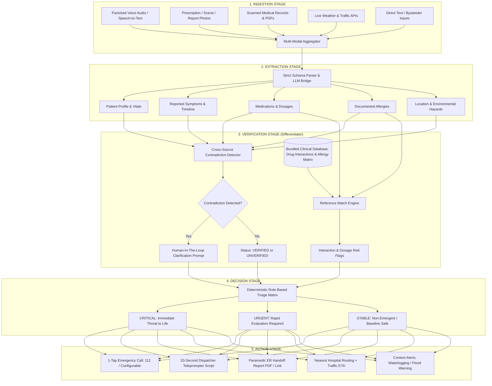

# LifeLine System Architecture & Data Flow

## Safety & Trust Model
1. **Decision-Support Non-Diagnostic Policy**: LifeLine explicitly acts as an emergency coordination assistant. It NEVER claims definitive clinical diagnosis.
2. **Deterministic Triage**: The triage level (CRITICAL / URGENT / STABLE) is generated through audited rule trees, avoiding LLM hallucination for safety-critical calls.
3. **Never Guess Silently**: Conflicting information triggers an interactive clarification prompt rather than choosing one fact probabilistically.
